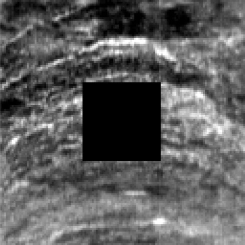
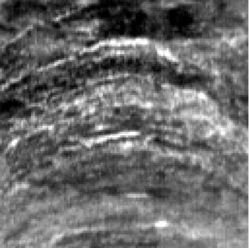

# TPSSR — Hyperspectral Pixel Reconstruction

**Recover missing and corrupted reflectance values in hyperspectral images.**

TPSSR (Texture-Preserving Spatio-Spectral Reconstruction) combines spectral interpolation, learned neighbor fusion, and geometry/topology-guided region reconstruction. A **learned router** selects the reconstruction expert for each target pixel.

  

## ✨ Features

- Three complementary reconstruction experts with a trained, pixel-level router.
- Ten synthetic corruption patterns, each with five severity levels.
- RMSE, MAE, R² and spectral angle (SAM) evaluation.

## 🖼️ Example: Missing Pixels and Reconstruction

These are cropped panels from a SWIR image reconstruction example.

| Corrupted input | TPSSR reconstruction |
|:--:|:--:|
|  |  |

## 📁 Project Structure

```text
TPSSR-HSI-Pixel-Reconstruction/
├── tpssr.py              
├── experiment_config.py  
├── prepare_dataset.py     
├── train.py               
├── train_region_lineaware.py
├── test.py               
├── evaluate.py           
├── benchmarks.py         
├── external_methods.py    
├── core/                  
├── training/             
├── tools/                 
├── tests/                 
├── assets/                
├── input_raw/
│   ├── train/
│   │   ├── SWIR1/
│   │   ├── SWIR2/
│   │   ├── SWIR3/
│   │   └── SWIR4/
│   └── test/
│       └── SWIR5/
├── external/
│   ├── DDS2M/              # Created by setup-external (not tracked)
│   └── PFGIN/              # Created by setup-external (not tracked)
├── external_source_lock.json # Original project source fingerprints
├── requirements.txt
└── LICENSE
```

## 🚀 Installation

```bash
git clone https://github.com/Abolfazlmsl/TPSSR-HSI-Pixel-Reconstruction.git
cd TPSSR-HSI-Pixel-Reconstruction
python3 -m venv .venv
source .venv/bin/activate
pip install -r requirements.txt
```

Install a PyTorch/CUDA build compatible with your system if needed. To run the CPU regression tests:

```bash
pip install -r requirements-dev.txt
pytest -q
```

## 📥 Dataset Preparation

Place **each acquisition in a separate subfolder** named `SWIRn` or `VNIRn`, where `n` is a positive number. Put training acquisitions under `input_raw/train/` and completely held-out acquisitions under `input_raw/test/`.

For example:

```text
input_raw/
├── train/
│   ├── SWIR1/
│   │   ├── sample.hdr
│   │   ├── sample.raw
│   │   ├── WHITEREF.hdr
│   │   ├── WHITEREF.raw
│   │   ├── DARKREF.hdr
│   │   └── DARKREF.raw
│   ├── SWIR2/
│   ├── SWIR3/
│   └── SWIR4/
└── test/
    ├── SWIR5/
    └── SWIR6/
```

## 🔧 Training Overview

### 1. Prepare reflectance cubes and evaluation masks

```bash
python tpssr.py prepare --from-folders
python tpssr.py preflight --from-folders --data-only
```

### 2. Train TPSSR

```bash
python tpssr.py train --from-folders --stage all
python tpssr.py train-region --from-folders
python tpssr.py train --from-folders --stage fusion
python tpssr.py train --from-folders --stage router3_lineaware
python tpssr.py train --from-folders --stage router3_lineaware_rankcv
```

### 3. Test and evaluate

```bash
python tpssr.py preflight --from-folders
python tpssr.py test --from-folders
python tpssr.py evaluate --from-folders
```

## 🔍 Reconstruction Methods

| Component | Function |
|---|---|
| Spectral Interpolation | Estimates missing bands from a valid spectrum at the same pixel |
| Learned Neighbor Fusion | Uses spatially neighboring spectra to supplement local spectral trends |
| Geometry/Topology Region | Restores spatial structures and continuity where local information is insufficient |
| Learned Router | Selects a suitable expert for target pixels from learned reconstruction-quality estimates |

## 📊 Benchmarking and Visualization

```bash
python tpssr.py benchmarks --from-folders --method all
```

### Install DDS2M and PFGIN (once)

```bash
python tpssr.py setup-external
```

### Run external benchmarks

```bash
# Train PFGIN on the training acquisitions, then evaluate it on the test acquisitions.
python tpssr.py external --from-folders --method pfgin --stage both

# DDS2M is self-supervised and does not need a separate training stage.
python tpssr.py external --from-folders --method dds2m --stage test
```

To run both in sequence:

```bash
python tpssr.py external --from-folders --method all --stage both
```

## 🧪 Reproduce the Original Evaluation Protocols

Predefined experiments remain available for reproducing the original paper splits and checkpoint names, independently of the new folder-based mode:

```bash
python tpssr.py prepare --preset swir_8x2
python tpssr.py test --preset swir_8x2
python tpssr.py evaluate --preset swir_8x2
```

Other built-in presets are `swir_region_a_to_b`, `swir_region_b_to_a` and `vnir_8x2`.

## 💾 Outputs and Checkpoints

| Directory | Contents |
|---|---|
| `processed_data/` | Calibrated reflectance cubes and validity masks |
| `simulated_saturation/` | Reproducible artificial damage masks |
| `trained_models/` | Learned experts and router checkpoints |
| `results/` | Prediction metrics and coverage |
| `figures/` | Generated visualizations |

## 📜 License

This project is released under the MIT License.

You may freely use and adapt the code for research and educational purposes.

See the [License](LICENSE) file for full details.
